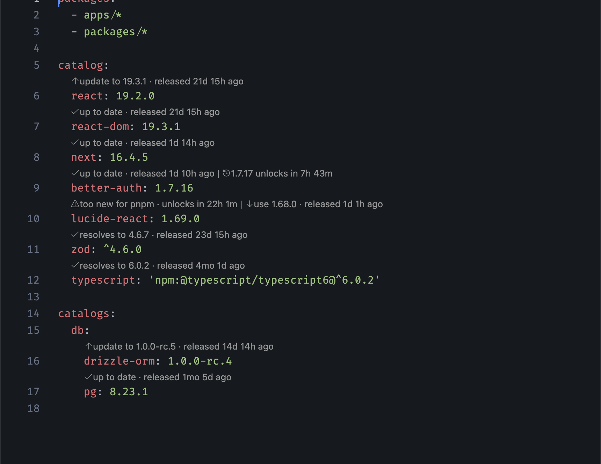
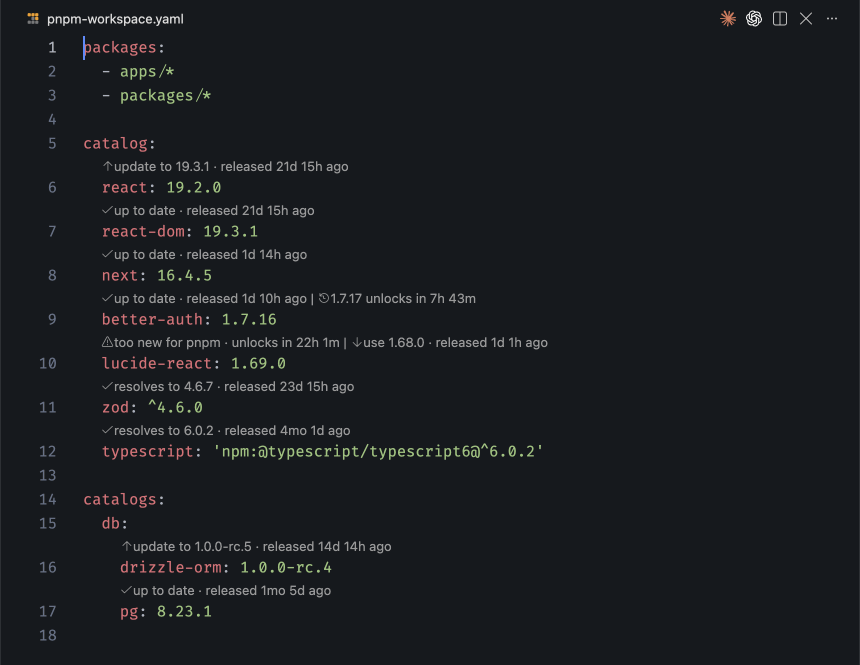

# pnpm Safe Lens

Know which dependency version you can install **before** pnpm refuses it.

pnpm 11 and later skip any version published in the last 24 hours (`minimumReleaseAge`). Most version lenses still offer you the newest release. You pick it, `pnpm install` fails with `ERR_PNPM_MINIMUM_RELEASE_AGE_VIOLATION`, and the fix ends up being another line in `minimumReleaseAgeExclude`.

pnpm Safe Lens reads the same rules pnpm uses and shows, for every entry in your `pnpm-workspace.yaml` catalogs, the newest version that will actually install today.



Click a lens to apply it. Here `react` is updated, `lucide-react` is moved back from a version pnpm would block, and `drizzle-orm` moves to the next release candidate:



## Install

Search for **pnpm Safe Lens** in the Extensions view, or open Quick Open (⌘P / Ctrl+P) and run:

```
ext install zigang93.pnpm-safe-lens
```

Then open your `pnpm-workspace.yaml`.

## What each lens means

| Lens | Meaning | Click it to |
| --- | --- | --- |
| `↑ update to 19.3.1 · released 21d ago` | A newer version is past the release-age window | Update the entry |
| `✓ up to date · released 1d 13h ago` | Nothing newer is installable | |
| `🕐 1.7.17 unlocks in 7h 57m` | A newer version exists, but pnpm blocks it for now | |
| `⚠ too new for pnpm · unlocks in 22h 15m` | The version you pinned can't be installed yet | |
| `↓ use 1.68.0 · released 1d 1h ago` | The newest version that does install | Switch to it |
| `✓ resolves to 4.6.7` | For a range such as `^4.6.0`, what pnpm resolves today | |

## Features

- **Uses pnpm's own rules.** The window comes from `minimumReleaseAge` in `pnpm-workspace.yaml`, then your pnpm config (global config, `.npmrc`, environment), then pnpm's built-in default for the pnpm version you have installed. You never configure it twice.
- **Honours exclusions.** `minimumReleaseAgeExclude` works exactly as in pnpm: `next`, `@scope/*`, or `better-auth@1.7.17 || 1.7.18`.
- **Every catalog.** The default `catalog:` and every named catalog under `catalogs:`.
- **`npm:` aliases.** `typescript: 'npm:@typescript/typescript6@^6.0.2'` is checked against `@typescript/typescript6`.
- **Ranges.** `^` and `~` ranges show what they resolve to, and an update keeps the operator.
- **Prerelease tracks.** `drizzle-orm: 1.0.0-rc.4` is offered `rc.5`, never a snapshot build such as `1.0.0-rc.5-ab785fc`. Stable entries only see stable releases up to the `latest` tag.
- **Skips deprecated versions.**
- **Your registry.** Package data comes from the registry pnpm is configured to use.
- **One click.** Clicking an update lens rewrites the version in place and keeps your quotes.

## Fast on every start

Publish dates live only in the registry's full package document, which is large: about 30 MB for `next`. The extension keeps a small digest on disk, so the expensive download happens once.

Measured on a catalog with 105 packages:

| Situation | Lenses visible after |
| --- | --- |
| First run, nothing cached | 5.9 s, filling in as packages arrive |
| Window reload | 27 ms |
| Cache older than 30 minutes | 36 ms, then a background check finishes in 0.8 s |

The background check sends the stored ETag, so an unchanged package comes back as an empty `304 Not Modified` instead of being downloaded again. The extension activates only when a YAML file opens, and its bundle loads in about 6 ms.

## Where the release-age window comes from

1. `minimumReleaseAge` in the open `pnpm-workspace.yaml`. Edits apply as you type.
2. `pnpm config get minimumReleaseAge`, which covers global config, `.npmrc` and environment variables.
3. pnpm's default: 1 day on pnpm 11 and later, no check on older versions.

Hover over any lens to see which one is in effect.

## Settings

| Setting | Default | Description |
| --- | --- | --- |
| `pnpmSafeLens.enabled` | `true` | Show the lenses |
| `pnpmSafeLens.cacheTtlMinutes` | `30` | How long cached package data counts as fresh before a background check |

## Commands

- **pnpm Safe Lens: Refresh versions** drops the cache and re-reads pnpm's config.

## Requirements

- VS Code 1.90 or later.
- pnpm on your `PATH` for the config lookup. Without it, the extension assumes pnpm 11's 1-day default.

## Known limitations

- Per-scope registries (`@scope:registry=...`) and registry auth tokens aren't read yet, so private packages show a registry error.
- Range entries show what a fresh resolution would pick, not the version in your lockfile.

## Privacy

The extension sends one request per package to your configured registry and nothing anywhere else.
